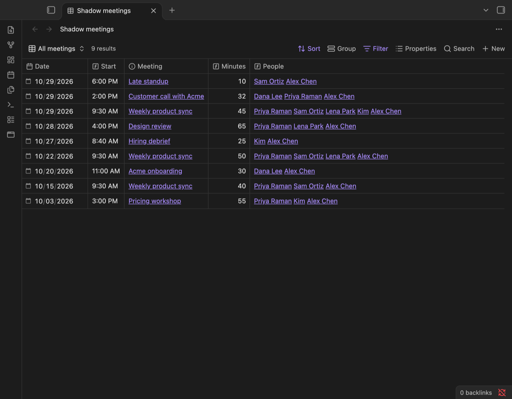
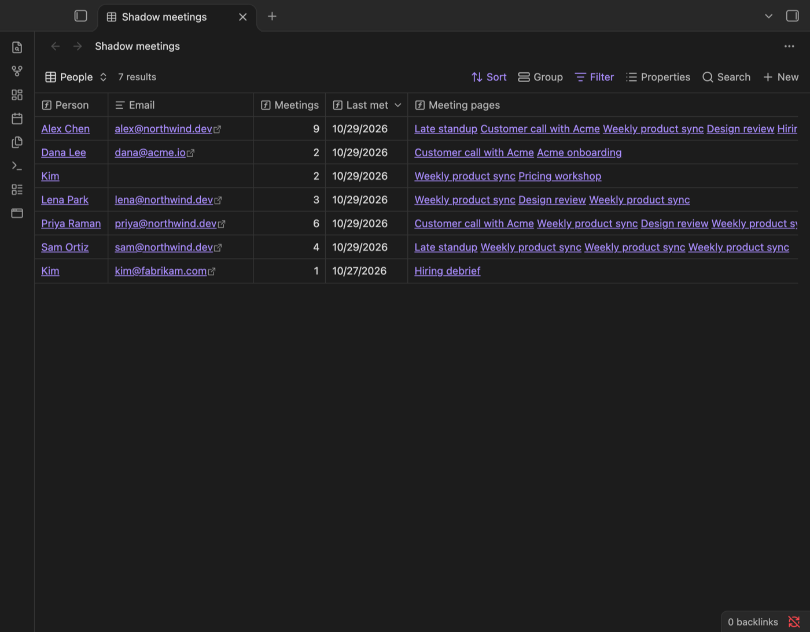
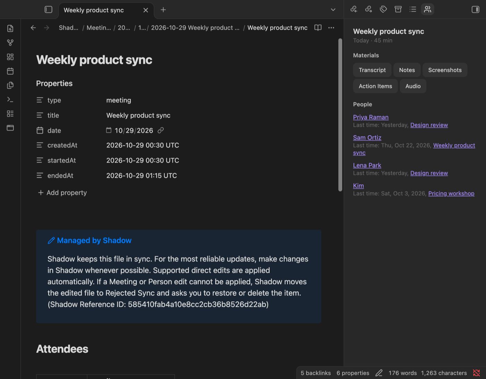
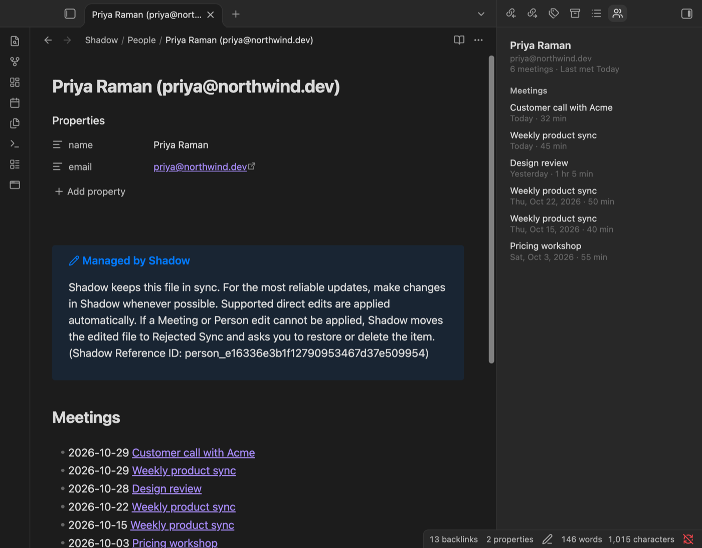
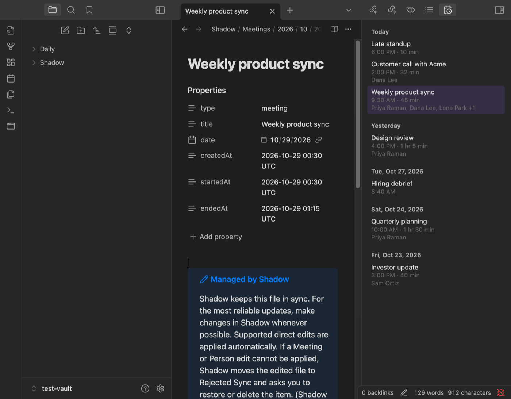

# Shadow Meetings

**Turn the meeting notes [Shadow](https://www.shadow.do) saves in your vault into Bases tables of meetings and people, see every past meeting with a person, and link today's meetings in your daily note. Requires the Shadow Mac app (Apple Silicon, macOS 14.2 or later), which records meetings without a bot and transcribes them on your Mac.**

Shadow already writes every meeting in Obsidian's own format: a meeting page with properties, a page per person, links between meetings and people, and the transcript, notes, audio and Skill results next to each meeting. Shadow Meetings builds on exactly that. It never edits the pages Shadow manages.

## Features

### Ready-made Bases views

Run **Create Shadow meeting views** and pick a folder. The plugin writes one `Shadow meetings.base` file (Obsidian core Bases) with three views:

- **All meetings**: date, start time, meeting, length in minutes and the people in it, newest first.
- **This week**: the same table for the current week.
- **People**: every person with their number of meetings, the date you last met, and links to each meeting.

The views use only what Shadow writes: the `type`, `date`, `startedAt` and `endedAt` properties on meeting pages, `name` and `email` on person pages, and the links between them. The file is yours to change.





### Person and meeting context

The **Shadow meeting context** panel follows the page you have open.

- **On a person page:** every meeting with that person, newest first, and when you last met.
- **On a meeting page:** each attendee with the last earlier meeting you had with them ("Last time: Yesterday, Design review"), plus one-click buttons for the meeting's Transcript, Notes, Screenshots, Skill results and Audio.

People are matched the way Shadow matches them: by email first, and by name only for people without an email. Two people with the same name and different emails stay separate.





### Daily note links

Turn on **Daily note links** in the plugin settings, then run **Add today's meetings to the daily note**. The plugin adds a link to each of today's meetings under a `Meetings` heading in today's daily note (core Daily notes or Periodic Notes), skipping meetings already linked there. It is off by default, and it writes only when you run the command.

### Meetings list

A sidebar list of every Shadow meeting, newest first, grouped under Today, Yesterday and earlier dates, with start time, length and attendees. It updates as soon as Shadow saves a new meeting.



### Also included

- **Open today's meetings** opens today's meeting page, or asks which one when there were several.
- **Open Shadow** (command and ribbon button) brings the Shadow app to the front through its `shadow-v23://` link.
- **Shadow folder** setting: the plugin finds the folder that holds Shadow's `SHADOW.md` on its own, or you can set it.

## Requirements and disclosures

- **The Shadow Mac app is required.** The plugin records and transcribes nothing itself. Shadow runs on Apple Silicon Macs with macOS 14.2 or later, captures system audio and your microphone so no bot joins the Zoom, Google Meet, Teams or Slack call, and transcribes on device. Download it at [shadow.do/download](https://www.shadow.do/download).
- **A Shadow account is required.** You sign in to the Shadow app with a link sent to your email.
- **Payment is optional.** The Free plan includes unlimited recording and transcription. AI notes need Shadow Plus, $12/month or $8/month billed yearly. The plugin itself is free and works the same on every plan.
- **No network use.** The plugin makes no network requests and has no telemetry. It reads meeting and person pages from Obsidian's own index of the vault and never reads files outside it. "Open Shadow" hands a `shadow-v23://open` link to macOS, which opens the app on your Mac.
- **What it writes.** Only two things, and only when you run the command: the `Shadow meetings.base` file in the folder you pick, and links in today's daily note. It never edits the pages Shadow manages (marked "Managed by Shadow"), so it cannot conflict with Shadow's sync.
- **Desktop only**, because the Shadow app runs on macOS. The Bases views need the Bases core plugin.

## Setup

1. Install Shadow and sign in.
2. In Shadow, open **Settings → Meeting → Vault location** and choose this Obsidian vault, or a folder inside it.
3. In Obsidian, install and enable **Shadow Meetings** from **Settings → Community plugins**. The meetings list and the context panel open in the right sidebar.
4. Run **Create Shadow meeting views** from the command palette to add the Bases views.

## Commands

| Command | What it does |
| --- | --- |
| Create Shadow meeting views | Writes `Shadow meetings.base` into a folder you pick. |
| Show meeting context | Opens the context panel in the right sidebar. |
| Add today's meetings to the daily note | Links today's meetings in today's daily note. Shown only when **Daily note links** is on. |
| Show meetings list | Opens the meetings list in the right sidebar. |
| Open today's meetings | Opens today's meeting page, or asks which one. |
| Open Shadow | Brings the Shadow app to the front. Also on the ribbon. |

The plugin sets no hotkeys. Add your own in **Settings → Hotkeys**.

## Settings

- **Shadow folder.** The folder that holds `SHADOW.md`, `Meetings` and `People`, relative to the vault root. Leave it empty to find it automatically. Use `/` when the whole vault is the Shadow folder. Select **Detect** to fill in the folder the plugin found.
- **Daily note links.** Off by default. Turns on the daily note command.

## How Shadow lays out the folder

```
<Shadow folder>/
  SHADOW.md
  Meetings/<year>/<month>/<YYYY-MM-DD title>/
    <title>.md          meeting page
    Transcript.md, Meeting Notes.md, Meeting Outline.md, Skill results, Audio.m4a
  People/<name> (<email>).md, or People/<name>.md without an email
```

A meeting page has these properties, an `## Attendees` table linking each person's page, and a `## Materials` list:

```yaml
type: meeting
title: "Weekly product sync"
date: 2026-10-29
createdAt: "2026-10-29 00:30 UTC"
startedAt: "2026-10-29 00:30 UTC"
endedAt: "2026-10-29 01:15 UTC"
```

A person page has `name` and an optional `email`, and a newest-first `## Meetings` list. The day comes from `date`, the local day the meeting started. Copies that Shadow sets aside under `Unsynced Files/` or `Archived Vaults/` are not listed.

## Development

```bash
npm install
npm run dev      # watch build
npm run build    # type check and production build
npm test         # unit tests
npm run lint
```

Copy `main.js`, `manifest.json` and `styles.css` to `<vault>/.obsidian/plugins/shadow-meetings/` to try a build.

## Support

Questions and bug reports: open an issue in this repository or email support@shadow.do.

## License

[MIT](LICENSE)
